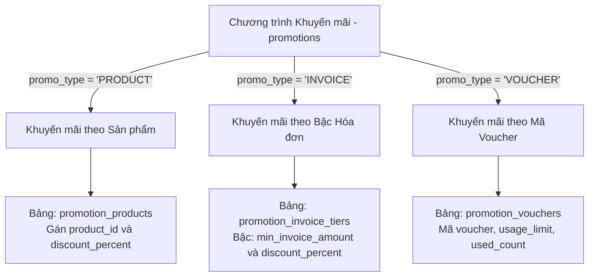

# BẢN KẾ HOẠCH TRIỂN KHAI CHỨC NĂNG M11: KHUYẾN MÃI VÀ VOUCHER

> **Dự án**: Hệ thống bán giày Web – Mobile (Shoes Store Application)  
> **Chức năng**: **M11 - Khuyến mãi và voucher (Promotions & Vouchers)**  
> **Người phụ trách**: Nguyễn Đức Tài (Phụ trách nhóm: M9, M10, M11, M12, M13, M16)  
> **Nhánh Git**: `feature/M11` (Merge vào: `develop`)  
> **Tài liệu căn cứ**: `feature_phanChiaNV .docx`, `database/shoestore_schema.sql`

---

## MỤC LỤC
1. [Tổng quan hệ thống Khuyến mãi (M11)](#1-tổng-quan-hệ-thống-khuyến-mãi-m11)
2. [Chi tiết 3 loại hình khuyến mãi](#2-chi-tiết-3-loại-hình-khuyến-mãi)
   - [2.1 Khuyến mãi theo sản phẩm (PRODUCT)](#21-khuyến-mãi-theo-sản-phẩm-product)
   - [2.2 Khuyến mãi theo mức tiền hóa đơn (INVOICE)](#22-khuyến-mãi-theo-mức-tiền-hóa-đơn-invoice)
   - [2.3 Khuyến mãi theo mã Voucher (VOUCHER)](#23-khuyến-mãi-theo-mã-voucher-voucher)
3. [Thuật toán phối hợp 3 loại & Quy tắc chống cộng dồn](#3-thuật-toán-phối-hợp-3-loại--quy-tắc-chống-cộng-dồn)
4. [Thiết kế API Endpoint cho cả 3 loại khuyến mãi](#4-thiết-kế-api-endpoint-cho-cả-3-loại-khuyến-mãi)
5. [Kế hoạch triển khai kỹ thuật (Backend, Admin Web, Mobile App)](#5-kế-hoạch-triển-khai-kỹ-thuật)
6. [Checklist kiểm thử & Kịch bản nghiệm thu](#6-checklist-kiểm-thử--kịch-bản-nghiệm-thu)

---

## 1. TỔNG QUAN HỆ THỐNG KHUYẾN MÃI (M11)

M11 chịu trách nhiệm quản lý toàn bộ các chính sách giảm giá, ưu đãi và phát hành mã giảm giá trong hệ thống. CSDL quản lý tập trung thông qua 4 bảng chính:
- `promotions`: Bảng cha định nghĩa chương trình khuyến mãi (Tên, Loại, Ngày bắt đầu, Ngày kết thúc, Trạng thái hoạt động, Xóa mềm).
- `promotion_products`: Bảng con lưu danh sách sản phẩm và `%` giảm giá (dành cho loại `PRODUCT`).
- `promotion_invoice_tiers`: Bảng con lưu các bậc chiết khấu theo tổng tiền (dành cho loại `INVOICE`).
- `promotion_vouchers`: Bảng con lưu danh sách mã voucher, giới hạn lượt dùng và số lượt đã dùng (dành cho loại `VOUCHER`).

---

## 2. CHI TIẾT 3 LOẠI HÌNH KHUYẾN MÃI



---

### 2.1 KHUYẾN MÃI THEO SẢN PHẨM (`PRODUCT`)

#### A. Mục đích & Nghiệp vụ
- Giảm giá trực tiếp trên từng sản phẩm cụ thể nhằm thúc đẩy doanh số, xả kho hoặc kích cầu các dòng sản phẩm giày mới.
- Khách hàng duyệt Web/App sẽ thấy giá gốc bị gạch ngang và hiển thị giá bán thực tế sau giảm.
- Khi thêm vào giỏ và đặt hàng, từng dòng chi tiết đơn (`invoice_details`) sẽ ghi nhận mức giảm giá này.

#### B. Cấu trúc CSDL
```sql
CREATE TABLE promotion_products (
    promotion_id     INT NOT NULL REFERENCES promotions(promotion_id),
    product_id       INT NOT NULL REFERENCES products(product_id),
    discount_percent DECIMAL(5,2) NOT NULL CONSTRAINT ck_pp_pct CHECK (discount_percent > 0 AND discount_percent <= 100),
    PRIMARY KEY (promotion_id, product_id)
);
```

#### C. Quy tắc tính toán & Truy vấn
- **Thời gian hiệu lực**: Tính theo ngày giờ Việt Nam (`SE Asia Standard Time`).
- **Quy tắc lấy mức giảm cao nhất (Không cộng dồn)**: Một sản phẩm có thể vô tình nằm trong 2 chương trình `PRODUCT` đang chạy cùng lúc. Hệ thống chỉ lấy mức `%` giảm **lớn nhất**:
  ```sql
  SELECT pp.product_id, MAX(pp.discount_percent) AS best_discount_percent
  FROM promotions pr
  JOIN promotion_products pp ON pp.promotion_id = pr.promotion_id
  WHERE pr.is_deleted = 0 
    AND pr.is_active = 1 
    AND pr.promo_type = 'PRODUCT'
    AND CAST(SYSDATETIMEOFFSET() AT TIME ZONE 'SE Asia Standard Time' AS DATE)
        BETWEEN pr.start_date AND pr.end_date
    AND pp.product_id IN (@productIds)
  GROUP BY pp.product_id;
  ```
- **Công thức tính tiền**:
  $$\text{discount\_price} = \text{current\_price} - \text{Math.round}\left(\frac{\text{current\_price} \times \text{best\_discount\_percent}}{100}\right)$$
- **Áp dụng vào đơn hàng (`invoice_details`)**:
  - `sale_price` = `it.price` (giá gốc của sản phẩm).
  - `discount_amount` = `Math.round(it.quantity * it.price * pct / 100)`.
  - `line_total` = `(quantity * sale_price) - discount_amount`.

---

### 2.2 KHUYẾN MÃI THEO MỨC TIỀN HÓA ĐƠN (`INVOICE`)

#### A. Mục đích & Nghiệp vụ
- Khuyến khích khách hàng mua nhiều sản phẩm để đạt mốc giá trị cao (kích thích tăng giá trị trung bình trên mỗi đơn hàng - AOV).
- Không cần nhập mã, hệ thống tự động kiểm tra tổng tiền hàng trong giỏ/đơn và áp dụng bậc chiết khấu cao nhất mà đơn đạt được.

#### B. Cấu trúc CSDL
```sql
CREATE TABLE promotion_invoice_tiers (
    promotion_id       INT NOT NULL REFERENCES promotions(promotion_id),
    min_invoice_amount DECIMAL(18,2) NOT NULL CONSTRAINT ck_pit_min CHECK (min_invoice_amount >= 0),
    discount_percent   DECIMAL(5,2) NOT NULL CONSTRAINT ck_pit_pct CHECK (discount_percent > 0 AND discount_percent <= 100),
    PRIMARY KEY (promotion_id, min_invoice_amount)
);
```

#### C. Ví dụ thiết lập bậc chiết khấu (Tiers)
Chương trình: *"Tri ân khách hàng tháng 10"*:
- Đơn từ **500.000 đ** $\rightarrow$ Giảm **5%**
- Đơn từ **1.000.000 đ** $\rightarrow$ Giảm **10%**
- Đơn từ **2.000.000 đ** $\rightarrow$ Giảm **15%**

#### D. Thuật toán tìm bậc giảm giá
- Khi khách có tổng tiền hàng là $T$ (sau khi đã trừ các khuyến mãi sản phẩm ở mục 2.1):
  ```sql
  SELECT TOP 1 pit.promotion_id, pit.discount_percent
  FROM promotion_invoice_tiers pit
  JOIN promotions p ON p.promotion_id = pit.promotion_id
  WHERE p.promo_type = 'INVOICE'
    AND p.is_active = 1 
    AND p.is_deleted = 0
    AND CAST(SYSDATETIMEOFFSET() AT TIME ZONE 'SE Asia Standard Time' AS DATE) BETWEEN p.start_date AND p.end_date
    AND pit.min_invoice_amount <= @totalAmount
  ORDER BY pit.discount_percent DESC;
  ```
- Nếu đơn hàng có tổng tiền $1.500.000\text{ đ}$, đơn thỏa mãn cả mốc 500k và 1tr $\rightarrow$ Hệ thống tự động chọn mốc **10%**.

---

### 2.3 KHUYẾN MÃI THEO MÃ VOUCHER (`VOUCHER`)

#### A. Mục đích & Nghiệp vụ
- Dùng trong các chiến dịch marketing cá nhân hóa, phát coupon cho khách VIP, mã voucher quà tặng, hoặc mã giảm giá độc quyền trên app/mạng xã hội.
- Khách hàng phải tự tay nhập mã (hoặc bấm nút "Áp dụng" từ danh sách voucher đã lưu).
- Kiểm soát số lượt sử dụng chặt chẽ bằng `usage_limit` và `used_count`.

#### B. Cấu trúc CSDL
```sql
CREATE TABLE promotion_vouchers (
    promotion_id     INT NOT NULL REFERENCES promotions(promotion_id),
    voucher_code     VARCHAR(30) NOT NULL UNIQUE,           -- Duy nhất, không tái sử dụng
    discount_percent DECIMAL(5,2) NOT NULL CONSTRAINT ck_pv_pct CHECK (discount_percent > 0 AND discount_percent <= 100),
    usage_limit      INT NULL CONSTRAINT ck_pv_limit CHECK (usage_limit > 0),
    used_count       INT NOT NULL DEFAULT 0 CONSTRAINT ck_pv_used CHECK (used_count >= 0),
    is_deleted       BIT NOT NULL DEFAULT 0,
    deleted_at       DATETIME2(3) NULL,
    PRIMARY KEY (promotion_id, voucher_code)
);
```

#### C. Thuật toán phát sinh mã Voucher hàng loạt (Batch Generation)
- Loại bỏ các ký tự gây nhầm lẫn thị giác như `0` (số 0) và `O` (chữ O), `1` (số 1) và `I` (chữ I):
  ```typescript
  const ALPHABET = 'ABCDEFGHJKLMNPQRSTUVWXYZ23456789'; // 32 ký tự an toàn
  function generateVoucherCode(length = 8): string {
    const bytes = crypto.randomBytes(length);
    return Array.from(bytes, (b) => ALPHABET[b % ALPHABET.length]).join('');
  }
  ```
- **Xử lý trùng lặp**: Do cột `voucher_code` có ràng buộc `UNIQUE`, khi insert hàng loạt nếu xảy ra đụng độ mã, vòng lặp tự động retry sinh mã mới tối đa 5 lần.

#### D. Thuật toán sử dụng Voucher nguyên tử (Atomic Update - Tránh Race Condition)
Tránh việc 2 khách hàng thanh toán đồng thời tranh nhau 1 lượt cuối cùng:
```sql
UPDATE promotion_vouchers
SET used_count = used_count + 1
WHERE voucher_code = @code
  AND is_deleted = 0
  AND (usage_limit IS NULL OR used_count < usage_limit);

-- Nếu rowsAffected = 0 nghĩa là đã hết lượt hoặc mã không hợp lệ
IF @@ROWCOUNT = 0
  THROW 50010, N'Mã voucher đã hết lượt sử dụng hoặc không hợp lệ!', 1;
```

#### E. Hoàn lại lượt Voucher khi Hủy đơn hàng
Khi đơn hàng chuyển sang trạng thái `CANCELLED`:
```sql
UPDATE promotion_vouchers
SET used_count = used_count - 1
WHERE voucher_code = @code AND used_count > 0;
```

---

## 3. THUẬT TOÁN PHỐI HỢP 3 LOẠI & QUY TẮC CHỐNG CỘNG DỒN

### 3.1 Quy trình tính toán tổng thể của Đơn hàng

```
[Giỏ hàng / Đặt hàng]
        │
        ▼
[BƯỚC 1: Tính giảm giá từng sản phẩm (PRODUCT)]
  - Lấy MAX(discount_percent) của từng SP
  - Chiết khấu ghi vào từng dòng: invoice_details.discount_amount
  - Thành tiền từng dòng: line_total = (quantity * sale_price) - discount_amount
        │
        ▼
[BƯỚC 2: Tính tổng tiền đơn hàng (total_amount)]
  - total_amount = SUM(line_total)  (Trigger CSDL tự động cộng)
        │
        ▼
[BƯỚC 3: So sánh Giảm cấp Hóa đơn (INVOICE vs VOUCHER)]
  - Tìm % giảm theo bậc tiền: tierPercent (từ promotion_invoice_tiers)
  - Tìm % giảm theo mã voucher: voucherPercent (từ promotion_vouchers)
  - ÁP DỤNG QUY TẮC MAX: finalPercent = Math.max(tierPercent, voucherPercent)
        │
        ▼
[BƯỚC 4: Ghi nhận giảm giá cấp hóa đơn (invoices.discount_amount)]
  - discount_amount = Math.round(total_amount * finalPercent / 100)
  - invoices.promotion_id = ID của chương trình được chọn
  - invoices.voucher_code = Mã voucher (nếu voucher thắng hoặc được chọn)
        │
        ▼
[BƯỚC 5: Số tiền khách thực tế phải trả]
  - pay_amount = total_amount - invoices.discount_amount
```

### 3.2 Bảng ví dụ minh họa bằng số tiền thực tế

Giả sử khách hàng mua:
- **Sản phẩm A**: 2 đôi giày chạy bộ, giá gốc 1.000.000 đ/đôi. Sản phẩm A đang có CTKM `PRODUCT` giảm **10%**.
- **Sản phẩm B**: 1 đôi sneaker, giá gốc 800.000 đ/đôi (không có KM sản phẩm).
- **Hệ thống đang có CTKM `INVOICE`**: Đơn từ 2.000.000 đ giảm **5%**.
- **Khách hàng nhập mã Voucher `VIP10`**: Giảm **8%**.

| Bước | Diễn giải | Số tiền | Ghi chú |
|:---|:---|:---:|:---|
| **SP A** | $2 \times 1.000.000\text{ đ} = 2.000.000\text{ đ}$. Giảm 10% = $200.000\text{ đ}$ | **1.800.000 đ** | Ghi vào `invoice_details` dòng A |
| **SP B** | $1 \times 800.000\text{ đ} = 800.000\text{ đ}$. Giảm 0% | **800.000 đ** | Ghi vào `invoice_details` dòng B |
| **Tổng tiền hàng (`total_amount`)** | $1.800.000 + 800.000$ | **2.600.000 đ** | Trigger tự tính trên `invoices` |
| **Xét KM cấp Hóa đơn** | Đơn 2.600.000 đ thỏa mốc $\ge$ 2.000.000 đ | **5%** (Mức hóa đơn) | |
| **Xét Voucher `VIP10`** | Khách áp dụng mã `VIP10` | **8%** (Mức voucher) | |
| **Quy tắc Max (Không cộng dồn)** | $\max(5\%, 8\%) = 8\%$ | **8%** | **Voucher được áp dụng (8% > 5%)** |
| **Số tiền giảm cấp HĐ** | $2.600.000 \times 8\% = 208.000\text{ đ}$ | **208.000 đ** | Ghi vào `invoices.discount_amount` |
| **Khách thanh toán cuối cùng** | $2.600.000 - 208.000$ | **2.392.000 đ** | Đúng bằng công thức `total_amount - discount_amount` |

---

## 4. THIẾT KẾ API ENDPOINT CHO CẢ 3 LOẠI KHUYẾN MÃI

### 4.1 Nhóm API Quản trị Khuyến mãi (Admin)

#### 1. Quản lý chung chương trình (`promotions`)
- `GET /api/v1/promotions`: Lấy danh sách (Lọc theo `promo_type`, `is_active`, khoảng ngày, phân trang).
- `GET /api/v1/promotions/:id`: Chi tiết 1 chương trình (kèm dữ liệu con `products`, `tiers`, hoặc `vouchers`).
- `POST /api/v1/promotions`: Tạo chương trình mới (`promotion_name`, `promo_type`, `start_date`, `end_date`).
- `PUT /api/v1/promotions/:id`: Cập nhật tên, thời gian bắt đầu/kết thúc.
- `PATCH /api/v1/promotions/:id/status`: Bật/tắt kích hoạt (`is_active = true/false`).
- `DELETE /api/v1/promotions/:id`: Xóa mềm chương trình (`is_deleted = 1`).

#### 2. Cấu hình Khuyến mãi theo sản phẩm (`PRODUCT`)
- `GET /api/v1/promotions/:id/products`: Danh sách sản phẩm thuộc chương trình và `%` giảm.
- `PUT /api/v1/promotions/:id/products`: Đồng bộ danh sách sản phẩm.
  ```json
  {
    "products": [
      { "productId": 1, "discountPercent": 15 },
      { "productId": 4, "discountPercent": 20 }
    ]
  }
  ```

#### 3. Cấu hình Khuyến mãi theo bậc hóa đơn (`INVOICE`)
- `GET /api/v1/promotions/:id/tiers`: Danh sách các bậc chiết khấu.
- `PUT /api/v1/promotions/:id/tiers`: Đồng bộ các bậc chiết khấu.
  ```json
  {
    "tiers": [
      { "minInvoiceAmount": 500000, "discountPercent": 5 },
      { "minInvoiceAmount": 1000000, "discountPercent": 10 },
      { "minInvoiceAmount": 2000000, "discountPercent": 15 }
    ]
  }
  ```

#### 4. Quản lý & Cấp phát Voucher (`VOUCHER`)
- `GET /api/v1/promotions/:id/vouchers`: Danh sách voucher, số lượt giới hạn, số lượt đã dùng.
- `POST /api/v1/promotions/:id/vouchers`: Tạo thủ công 1 voucher.
  ```json
  { "voucherCode": "CHAOHET2026", "discountPercent": 10, "usageLimit": 100 }
  ```
- `POST /api/v1/promotions/:id/vouchers/generate-batch`: Sinh mã hàng loạt tự động.
  ```json
  { "count": 50, "discountPercent": 15, "usageLimit": 1, "codeLength": 8, "prefix": "VIP" }
  ```
- `PATCH /api/v1/vouchers/:code/status`: Vô hiệu hóa hoặc kích hoạt voucher.
- `DELETE /api/v1/vouchers/:code`: Xóa mềm voucher (`is_deleted = 1`).

---

### 4.2 Nhóm API Dành cho Khách hàng & Ứng dụng Mobile

#### 1. Lấy danh sách khuyến mãi đang chạy
- `GET /api/v1/promotions/active`: Trả về các chương trình đang hiệu lực (để hiển thị slider, banner hoặc trang Ưu đãi).
- `GET /api/v1/vouchers/public`: Danh sách các voucher công khai mà khách có thể bấm lấy/sử dụng.

#### 2. Kiểm tra & Áp dụng Voucher (Checkout Validation)
- `POST /api/v1/vouchers/validate`:
  - **Request Body**:
    ```json
    {
      "voucherCode": "VIP10",
      "totalAmount": 1500000
    }
    ```
  - **Response Success (200 OK)**:
    ```json
    {
      "valid": true,
      "voucherCode": "VIP10",
      "discountPercent": 8,
      "discountAmount": 120000,
      "finalAmount": 1380000,
      "message": "Áp dụng voucher thành công!"
    }
    ```
  - **Response Error (400 Bad Request)**:
    ```json
    {
      "valid": false,
      "code": "VOUCHER_EXPIRED_OR_EXHAUSTED",
      "message": "Voucher đã hết lượt sử dụng hoặc đã hết thời gian hiệu lực!"
    }
    ```

---

## 5. KẾ HOẠCH TRIỂN KHAI KỸ THUẬT

### 5.1 Phía Backend (`backend/src/`)
1. **Repository Layer**:
   - `backend/src/repositories/promotion.repository.ts`: Viết toàn bộ câu truy vấn cho 4 bảng (`promotions`, `promotion_products`, `promotion_invoice_tiers`, `promotion_vouchers`).
   - Tối ưu hóa truy vấn `orderPromotionRepository` (đã có khung ban đầu) để kết nối hoàn chỉnh với luồng tạo đơn (M8).
2. **Validator Layer**:
   - `backend/src/validators/promotion.validator.ts`: Schema Zod kiểm tra tính hợp lệ của dữ liệu đầu vào (tỷ lệ `%` từ 0.01 đến 100, `start_date <= end_date`, mã voucher không chứa ký tự đặc biệt).
3. **Service Layer**:
   - `backend/src/services/promotion.service.ts`: Xử lý nghiệp vụ logic chống cộng dồn, tạo mã voucher ngẫu nhiên an toàn, atomic update lượt voucher.
4. **Controller & Routes Layer**:
   - `backend/src/controllers/promotion.controller.ts` & `backend/src/routes/promotion.routes.ts`: Đăng ký middleware xác thực JWT, phân quyền `ADMIN` cho các tác vụ thay đổi và cho phép `CUSTOMER` truy vấn các API xem/validate.

### 5.2 Phía Admin Web (`admin/src/`)
1. **Trang Quản lý Khuyến mãi**:
   - Bảng hiển thị: Tên chương trình, Loại (`Sản phẩm` / `Hóa đơn` / `Voucher`), Ngày bắt đầu, Ngày kết thúc, Trạng thái (Badge xanh: Đang diễn ra, Badge xám: Đã kết thúc).
   - Switch Toggle bật/tắt nhanh `is_active`.
2. **Form Thêm/Sửa Chương trình Khuyến mãi**:
   - Nhập thông tin chung.
   - Chọn loại chương trình $\rightarrow$ Render Tab động tương ứng:
     - Tab 1: **Chọn sản phẩm & % giảm** (có Modal tìm kiếm giày theo danh mục, thương hiệu).
     - Tab 2: **Bậc tiền hóa đơn** (Nút thêm dòng bậc tiền: Từ X đồng $\rightarrow$ Giảm Y%).
     - Tab 3: **Quản lý Voucher** (Danh sách mã, số lượt đã dùng/giới hạn, nút bấm mở Modal "Sinh mã tự động").
3. **Modal Sinh mã Voucher hàng loạt**:
   - Input: Số lượng mã, `%` giảm, số lượt dùng mỗi mã.
   - Nút "Sinh mã" $\rightarrow$ Hiển thị bảng mã đã sinh kèm nút "Sao chép tất cả" hoặc "Xuất Excel".

### 5.3 Phía Mobile App (`mobile/src/`)
1. **Hiển thị giá khuyến mãi trên Sản phẩm**:
   - Tích hợp vào Card sản phẩm ở Trang chủ, Danh mục và Trang Chi tiết sản phẩm:
   - Hiển thị: Giá gạch ngang (giá gốc), Badge giảm giá màu đỏ (ví dụ `-15%`), Giá bán hiện tại màu đỏ đậm.
2. **Màn hình Giỏ hàng & Thanh toán (Checkout)**:
   - Mục "Mã giảm giá / Voucher":
     - Ô nhập mã + nút "Áp dụng".
     - Nút "Chọn voucher có sẵn" mở Modal danh sách voucher còn hiệu lực.
   - Phần Tóm tắt thanh toán:
     - Tạm tính: `2.600.000 đ`
     - Giảm giá voucher (`VIP10`): `-208.000 đ`
     - Tổng thanh toán: `2.392.000 đ`

---

## 6. CHECKLIST KIỂM THỬ & KỊCH BẢN NGHIỆM THU

### 6.1 Kiểm thử Đơn vị & Nghiệp vụ (Unit & Business Logic Test)
- [ ] **Test Ngày giờ**: Chương trình bắt đầu từ ngày mai $\rightarrow$ Hôm nay không được áp dụng.
- [ ] **Test Ngày hết hạn**: Chương trình kết thúc hôm qua $\rightarrow$ Hôm nay tự động hết hiệu lực.
- [ ] **Test Chống cộng dồn Sản phẩm**: Sản phẩm X thuộc CTKM A (giảm 10%) và CTKM B (giảm 20%) $\rightarrow$ Hệ thống tự động giảm đúng 20%.
- [ ] **Test Bậc Hóa đơn**: Đơn 1.200.000 đ với 2 bậc (500k giảm 5%, 1tr giảm 10%) $\rightarrow$ Giảm đúng 10%.
- [ ] **Test So sánh Hóa đơn vs Voucher**: Bậc hóa đơn là 5%, Voucher là 8% $\rightarrow$ Áp dụng mức 8%.

### 6.2 Kiểm thử Cạnh tranh & Ràng buộc (Edge Cases & Concurrency)
- [ ] **Voucher chạm trần lượt dùng**: Voucher có `usage_limit = 5`, khi `used_count` đạt 5 $\rightarrow$ Người thứ 6 bấm áp dụng phải nhận thông báo lỗi "Voucher đã hết lượt sử dụng".
- [ ] **Test Race Condition**: Giả lập 2 request cùng lúc sử dụng 1 voucher chỉ còn đúng 1 lượt $\rightarrow$ Đúng 1 request thành công, 1 request thất bại.
- [ ] **Test Hủy đơn hoàn Voucher**: Đặt đơn thành công dùng mã `TESTVOUCHER` (`used_count` từ 0 lên 1) $\rightarrow$ Hủy đơn hàng $\rightarrow$ `used_count` quay về 0.

### 6.3 Phân quyền (Authorization)
- [x] Khách hàng không thể gọi API tạo/sửa/xóa khuyến mãi (`403 Forbidden`).
- [x] Nhân viên không có quyền quản trị không thể xóa chương trình khuyến mãi.

---

## 7. TRẠNG THÁI HOÀN THÀNH CỦA M11

| Thành phần | Module | Trạng thái | Ghi chú |
|:---|:---|:---:|:---|
| **Backend Validator** | `promotion.validator.ts` |  **Hoàn thành** | Zod schemas cho CRUD, gán SP, bậc HĐ, sinh voucher, validate |
| **Backend Repository** | `promotion.repository.ts` |  **Hoàn thành** | Đầy đủ truy vấn 4 bảng promotions, products, tiers, vouchers |
| **Backend Service** | `promotion.service.ts` |  **Hoàn thành** | Chống cộng dồn, atomic voucher, sinh mã 32 ký tự an toàn |
| **Backend Controller & Routes** | `promotion.controller.ts`, `promotion.routes.ts` |  **Hoàn thành** | Phân quyền RBAC, validate request, đăng ký vào `/api/v1` |
| **Backend Build** | `dist/` |  **Hoàn thành** | `npm run build` thành công 100% |
| **Admin Types & Service** | `promotion.ts`, `promotion.service.ts` |  **Hoàn thành** | Định kiểu đầy đủ và Axios client |
| **Admin UI Page** | `AdminPromotionsPage.tsx` |  **Hoàn thành** | Giao diện quản lý 3 loại KM, panel cấu hình, sinh voucher hàng loạt |
| **Admin Routing** | `AppRoutes.tsx` |  **Hoàn thành** | Khai báo route `/admin/promotions` |
| **Admin Build** | `dist/` |  **Hoàn thành** | Vite build thành công không lỗi |
| **Mobile Types & Service** | `promotion.ts`, `promotion.service.ts` |  **Hoàn thành** | Hỗ trợ xem KM active, voucher public và validate voucher |
| **Mobile Typecheck** | `mobile/` |  **Hoàn thành** | TypeScript check thành công 100% |
