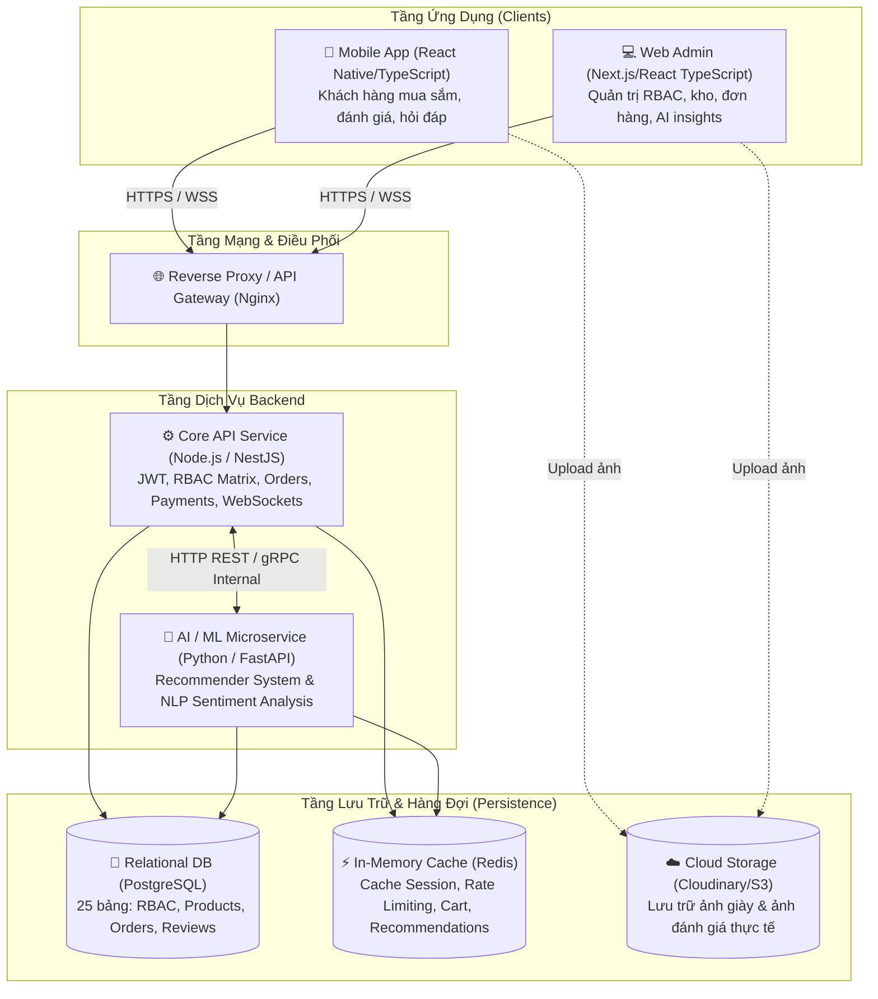

# KẾ HOẠCH & CẤU TRÚC THƯ MỤC HỆ THỐNG SHOES STORE APP
*(Hệ thống Quản lý và Bán giày Thể thao Đa nền tảng)*

Tài liệu này đặc tả chi tiết **Cấu trúc thư mục (Project Structure)**, tổ chức mã nguồn, phân chia module nghiệp vụ và lộ trình triển khai kỹ thuật cho toàn bộ dự án **Shoes Store App** dựa trên bản đặc tả yêu cầu ([requirements.txt](file:///c:/Users/vuvie/Documents/CNPM/ShoesStoreApp/requirements.txt)) và cơ sở dữ liệu ([diagrams/erd_spec.md](file:///c:/Users/vuvie/Documents/CNPM/ShoesStoreApp/diagrams/erd_spec.md)).

---

## 1. TỔNG QUAN KIẾN TRÚC HỆ THỐNG (SYSTEM ARCHITECTURE)

Hệ thống được thiết kế theo mô hình **Monorepo / Multi-Service Architecture**, phân tách rành mạch giữa nghiệp vụ lõi (Core Business), dịch vụ trí tuệ nhân tạo (AI/ML Service), giao diện quản trị (Web Admin) và ứng dụng người dùng (Mobile App):



---

## 2. SƠ ĐỒ CÂY THƯ MỤC TOÀN HỆ THỐNG (PROJECT TREE)

```text
ShoesStoreApp/
├── .gitignore                            # Cấu hình loại trừ Git bảo vệ .env, node_modules, file rác
├── readme.txt                            # Hướng dẫn nhanh cài đặt & chạy hệ thống cho nhóm
├── PROJECT_STRUCTURE.md                  # Bản kế hoạch kiến trúc & cấu trúc file này
├── neon.ts                               # Chính sách hạ tầng Serverless PostgreSQL Cloud (Neon)
├── requirements.txt                      # Bản đặc tả yêu cầu chức năng hệ thống
├── backend/                              # [DỊCH VỤ 1] Core API (Node.js - Express + Prisma ORM)
│   ├── package.json                      # Cấu hình dependencies & scripts Prisma
│   ├── .env                              # Biến môi trường kết nối Neon DB thật (ĐÃ BẢO MẬT)
│   ├── .env.example                      # Mẫu biến môi trường mẫu
│   ├── prisma/
│   │   ├── schema.prisma                 # 25 bảng ERD chuẩn hóa Type-safe (Serverless Postgres)
│   │   └── seeds/
│   │       └── seed.js                   # Script nạp dữ liệu mẫu khởi tạo (Admin, Roles, Giày mẫu)
│   ├── backup/
│   │   ├── backup.ps1                    # Script PowerShell tự động backup DB (pg_dump)
│   │   └── restore.ps1                   # Script PowerShell tự động restore DB (psql)
│   ├── src/
│   │   ├── app.js                        # Cấu hình Express middleware (cors, json, routes)
│   │   ├── server.js                     # Điểm khởi động HTTP Server
│   │   ├── config/
│   │   │   ├── database.js               # Prisma Client singleton chống rò rỉ connection
│   │   │   └── env.js                    # Validate & nạp biến môi trường
│   │   ├── constants/                    # role.constant.js, order.constant.js, message.constant.js
│   │   ├── errors/
│   │   │   └── AppError.js               # Định nghĩa lớp lỗi tập trung của hệ thống
│   │   ├── middleware/                   # auth.middleware.js, errorHandler.js, notFound.js
│   │   ├── routes/                       # auth, rbac, products, cart, orders, reviews, comments...
│   │   ├── controllers/                  # Tiếp nhận HTTP request & trả về response
│   │   ├── services/                     # Xử lý logic nghiệp vụ E-Commerce & gọi AI
│   │   ├── repositories/                 # Thao tác cơ sở dữ liệu qua Prisma Client
│   │   ├── validators/                   # Kiểm tra hợp lệ dữ liệu đầu vào (Joi / Zod)
│   │   └── utils/                        # jwt.util.js, hash.util.js, format.util.js
│   └── test/
│       └── api_test.http                 # Kiểm thử API trực tiếp trong VS Code (REST Client)
├── backend-ai/                           # [DỊCH VỤ 2] AI / ML Microservice (Python - FastAPI)
│   ├── app/
│   │   ├── main.py                       # Khởi tạo FastAPI App, cấu hình CORS, Routers
│   │   ├── core/                         # config.py, logger.py, security.py
│   │   ├── models/                       # Pydantic Schemas (Request / Response DTOs)
│   │   ├── api/v1/
│   │   │   ├── health.py                 # Health check probe
│   │   │   ├── recommender.py            # POST /recommend (Gợi ý giày cá nhân hóa)
│   │   │   └── sentiment.py              # POST /sentiment-analyze (NLP tiếng Việt)
│   │   ├── services/
│   │   │   ├── recommender/              # Động cơ gợi ý Collaborative + Content-based
│   │   │   └── sentiment/                # Xử lý ngôn ngữ tự nhiên NLP đánh giá tiếng Việt
│   │   ├── weights/                      # Lưu trữ file trọng số mô hình (.pkl, .pt)
│   │   └── data/                         # Tập dữ liệu mẫu huấn luyện
│   ├── requirements.txt                  # fastapi, uvicorn, scikit-learn, underthesea, torch
│   └── Dockerfile
├── admin/                                # [ỨNG DỤNG 1] Web Quản trị (React + Vite + TypeScript)
│   ├── index.html
│   ├── package.json
│   ├── vite.config.ts
│   ├── src/
│   │   ├── App.tsx, main.tsx
│   │   ├── components/                   # Header, Sidebar, ProjectTable, StatCard, PermissionGate
│   │   ├── pages/                        # Dashboard, Roles, Products, Inventory, Orders, Reviews
│   │   ├── routes/                       # protectedRoute.tsx, index.tsx
│   │   ├── services/                     # Gọi API Axios client
│   │   ├── store/                        # Quản lý State bằng Zustand (useAuthStore.ts)
│   │   ├── types/                        # Khai báo TypeScript types
│   │   └── utils/                        # Format VND, ngày tháng
│   └── public/
├── mobile/                               # [ỨNG DỤNG 2] Mobile App (React Native Expo Router / TS)
│   ├── app.json, package.json
│   ├── android/                          # Cấu hình Native Android, gradle, AndroidManifest
│   └── src/
│       ├── app/                          # Expo Router (File-based Routing)
│       │   ├── _layout.tsx
│       │   ├── (auth)/                   # login.tsx, register.tsx
│       │   ├── tabs/                     # index.tsx (Home), products.tsx, feedbacks.tsx, profile.tsx
│       │   ├── product/[id].tsx          # Chi tiết giày, chọn size 38-44, Size Guide
│       │   └── checkout.tsx              # Đặt hàng, VietQR, MoMo
│       ├── components/                   # app-button, product-card, rating-stars, variant-picker
│       ├── context/                      # auth-context.tsx
│       ├── services/                     # API client gọi Core Backend
│       ├── hooks/                        # use-api.ts, use-theme.ts, use-debounced-value.ts
│       └── utils/                        # format.ts, recommend.ts
├── diagrams/                             # [TÀI LIỆU THIẾT KẾ] Bản vẽ kiến trúc & ERD
│   ├── erd_diagram.png                   # Ảnh sơ đồ ERD siêu nét chuẩn 8K
│   ├── erd_spec.md                       # Đặc tả chi tiết 25 bảng dữ liệu & quan hệ
│   ├── erd_viewer.html                   # Trình xem trực quan ERD (Zoom / Pan)
│   └── generate_erd.py                   # Script Python tạo sơ đồ ERD
└── docs/                                 # [TÀI LIỆU BÁO CÁO ĐỒ ÁN]
    ├── Yeu_cau_do_an.docx                # Báo cáo yêu cầu nghiệp vụ
    ├── Flow_HoatDongCuaCode.docx         # Luồng hoạt động của mã nguồn
    └── database/
        ├── data-dictionary.md            # Từ điển dữ liệu chi tiết 25 bảng ERD
        └── migrations.txt                # Lịch sử đồng bộ cơ sở dữ liệu
```

---

## 3. CHI TIẾT CẤU TRÚC TỪNG PHÂN HỆ

### 3.1. Phân hệ Core API Backend (`backend/`)
Xây dựng trên nền tảng **Node.js (Express)** kết hợp **Prisma ORM** và **Serverless PostgreSQL (Neon)**, áp dụng mô hình phân tầng **4 lớp (Controller - Service - Repository - Validator)** bám sát 25 bảng ERD:

```text
backend/
├── package.json                          # Scripts: dev, prisma:generate, prisma:push, prisma:seed
├── .env                                  # Chuỗi kết nối Neon Postgres (Pooled + Direct) [BẢO MẬT]
├── .env.example                          # Mẫu cấu hình an toàn cho thành viên mới
├── backup/                               # Sao lưu & phục hồi dữ liệu DB (phục vụ đồ án CNPM)
│   ├── backup.ps1                        # Script PowerShell tự động backup DB (pg_dump)
│   └── restore.ps1                       # Script PowerShell tự động phục hồi DB (psql)
├── prisma/
│   ├── schema.prisma                     # Đặc tả 25 models ERD chuẩn hóa Type-safe
│   └── seeds/
│       └── seed.js                       # Nạp dữ liệu khởi tạo (Admin, Roles, Permissions, Giày mẫu)
├── test/
│   └── api_test.http                     # Kiểm thử API trực tiếp trong VS Code (REST Client)
└── src/
    ├── app.js                            # Cấu hình Express middleware (cors, json, logging)
    ├── server.js                         # Khởi chạy HTTP Server trên PORT cấu hình
    ├── config/
    │   ├── database.js                   # Xuất Prisma Client singleton chống rò rỉ kết nối
    │   └── env.js                        # Kiểm tra và nạp các biến môi trường
    ├── constants/
    │   ├── role.constant.js              # SUPER_ADMIN, SALES_STAFF, WAREHOUSE_STAFF, CUSTOMER
    │   ├── order.constant.js             # PENDING, PROCESSING, SHIPPING, DELIVERED, CANCELLED
    │   └── message.constant.js           # Chuỗi thông báo chuẩn hóa
    ├── errors/
    │   └── AppError.js                   # Lớp xử lý ngoại lệ tập trung (Custom HTTP Errors)
    ├── middleware/
    │   ├── auth.middleware.js            # Xác thực JWT Token & giải mã danh tính người dùng
    │   ├── checkPermission.middleware.js # Kiểm tra quyền trong RolePermission Matrix
    │   ├── errorHandler.middleware.js    # Bắt mọi lỗi và trả về JSON chuẩn
    │   └── notFound.middleware.js        # Xử lý 404 Route Not Found
    ├── routes/                           # Tầng Định tuyến URL
    │   ├── index.js                      # Gom tất cả route con vào tiền tố /api
    │   ├── auth.routes.js                # /api/auth (Login, Register, Refresh)
    │   ├── rbac.routes.js                # /api/rbac (Roles, Permissions Matrix)
    │   ├── product.routes.js             # /api/products, /api/variants (Size 38-44)
    │   ├── cart.routes.js                # /api/cart
    │   ├── order.routes.js               # /api/orders (Đặt hàng, cập nhật tiến độ)
    │   ├── payment.routes.js             # /api/payments (MoMo IPN, VietQR)
    │   ├── review.routes.js              # /api/reviews (Đánh giá, ảnh thật, fit feedback)
    │   └── comment.routes.js             # /api/comments (Hỏi đáp sản phẩm)
    ├── validators/                       # Tầng Kiểm tra hợp lệ dữ liệu đầu vào (Joi / Zod)
    │   ├── auth.validator.js
    │   ├── product.validator.js
    │   └── order.validator.js
    ├── controllers/                      # Tầng Tiếp nhận Request & trả lời Response
    │   ├── auth.controller.js
    │   ├── rbac.controller.js
    │   ├── product.controller.js
    │   ├── cart.controller.js
    │   ├── order.controller.js
    │   └── review.controller.js
    ├── services/                         # Tầng Xử lý Nghiệp vụ Logic (Business Logic)
    │   ├── auth.service.js
    │   ├── rbac.service.js
    │   ├── product.service.js
    │   ├── order.service.js
    │   ├── payment.service.js
    │   └── aiClient.service.js           # Giao tiếp HTTP với Python AI Microservice
    ├── repositories/                     # Tầng Thao tác Cơ sở dữ liệu (Prisma Client)
    │   ├── user.repository.js
    │   ├── role.repository.js
    │   ├── product.repository.js
    │   ├── variant.repository.js
    │   ├── order.repository.js
    │   └── review.repository.js
    └── utils/                            # Tiện ích bổ trợ
        ├── jwt.util.js                   # Ký và giải mã token
        ├── hash.util.js                  # Mã hóa mật khẩu BCrypt
        └── formatters.util.js            # Format tiền VND, mã SKU
```

---

### 3.2. Phân hệ Trí tuệ Nhân tạo Python (`backend-ai/`)
Xây dựng trên nền tảng **Python (FastAPI)**, chuyên trách 2 module thông minh phục vụ hệ sinh thái bán giày:

```text
backend-ai/
├── app/
│   ├── main.py                           # Khởi tạo FastAPI App, cấu hình CORS, Routers
│   ├── core/
│   │   ├── config.py                     # Cài đặt biến môi trường, đường dẫn mô hình
│   │   ├── logger.py                     # Cấu hình log xử lý
│   │   └── security.py                   # Xác thực API Key giữa Core API và AI Service
│   ├── models/                           # Pydantic Schemas (Định dạng dữ liệu vào/ra)
│   │   ├── recommender_schema.py         # RecommendationRequest, RecommendationResponse
│   │   └── sentiment_schema.py           # SentimentAnalysisRequest, SentimentAnalysisResponse
│   ├── api/v1/
│   │   ├── health.py                     # Kiểm tra trạng thái hoạt động dịch vụ
│   │   ├── recommender.py                # POST /api/v1/ai/recommend (Trả về danh sách product_id đề xuất)
│   │   └── sentiment.py                  # POST /api/v1/ai/sentiment-analyze (Gán nhãn Cảm xúc & Fit Feedback)
│   ├── services/
│   │   ├── recommender/                  # Module 1: Gợi ý sản phẩm thông minh
│   │   │   ├── collaborative.py          # Lọc cộng tác: Ma trận tương tác người dùng - giày
│   │   │   ├── content_based.py          # Lọc theo nội dung: Đặc tính giày (Brand, Category, Size, Price)
│   │   │   ├── hybrid_engine.py          # Phối hợp 2 thuật toán để giảm tình trạng Cold Start
│   │   │   └── trainer.py                # Script định kỳ huấn luyện lại mô hình theo dữ liệu mới
│   │   └── sentiment/                    # Module 2: Phân tích cảm xúc đánh giá tiếng Việt
│   │       ├── preprocessor.py           # Tiền xử lý: Chuẩn hóa Unicode, tách từ, lọc stopwords
│   │       ├── classifier.py             # Mô hình phân loại nhãn: POSITIVE, NEGATIVE, NEUTRAL
│   │       └── aspect_extractor.py       # Trích xuất khía cạnh: Đánh giá form giày (chật, rộng, vừa in)
│   ├── weights/                          # Nơi lưu trữ weights/checkpoint của mô hình
│   │   ├── sentiment_vietnamese_model/   # Mô hình NLP đã được fine-tune
│   │   └── recommender_matrix.pkl        # Ma trận trọng số đề xuất
│   └── data/                             # Tập dữ liệu mẫu dùng để kiểm thử & fine-tune
├── tests/
│   ├── test_recommender.py
│   └── test_sentiment.py
├── requirements.txt                      # fastapi, uvicorn, scikit-learn, numpy, pandas, underthesea, torch
└── Dockerfile
```

---

### 3.3. Phân hệ Web Quản trị Admin (`frontend-admin/`)
Xây dựng trên nền tảng **Next.js (App Router)** và **TypeScript**, giao diện hiện đại, chuyên nghiệp, hỗ trợ tối đa cho các vai trò quản trị (Super Admin, Quản lý kho, Kế toán, Chăm sóc khách hàng):

```text
frontend-admin/src/
├── app/
│   ├── layout.tsx                        # Root layout, ThemeProvider, ToastProvider, QueryClientProvider
│   ├── (auth)/
│   │   └── login/
│   │       └── page.tsx                  # Màn hình đăng nhập tài khoản quản trị
│   └── (dashboard)/                      # Toàn bộ màn hình quản trị được bảo vệ bởi RBAC Guard
│       ├── layout.tsx                    # Dashboard layout chứa Sidebar, Navbar, Notification Dropdown
│       ├── page.tsx                      # Dashboard Overview (KPI, Doanh thu, Đơn hàng mới, Tồn kho)
│       ├── rbac/
│       │   ├── roles/page.tsx            # Quản lý danh mục các vai trò (Roles)
│       │   └── matrix/page.tsx           # Ma trận gán/bỏ quyền hạn (Permissions Matrix) trực quan
│       ├── users/
│       │   ├── page.tsx                  # Danh sách người dùng, lọc theo vai trò, khóa/mở tài khoản
│       │   └── [id]/page.tsx             # Chi tiết người dùng, lịch sử mua hàng
│       ├── catalog/
│       │   ├── categories/page.tsx       # Quản lý danh mục (Sneaker, Chạy bộ, Sandal...)
│       │   ├── brands/page.tsx           # Quản lý thương hiệu (Nike, Adidas, Puma...)
│       │   └── suppliers/page.tsx        # Quản lý nhà cung cấp hàng
│       ├── products/
│       │   ├── page.tsx                  # Bảng danh sách giày, tìm kiếm, lọc theo danh mục
│       │   ├── create/page.tsx           # Thêm mới sản phẩm giày & tải ảnh lên
│       │   ├── [id]/edit/page.tsx        # Chỉnh sửa thông tin & bảng size guide
│       │   └── [id]/variants/page.tsx    # Quản lý bảng biến thể Size (36-45), Màu sắc, SKU & Giá
│       ├── inventory/
│       │   ├── page.tsx                  # Bảng theo dõi tồn kho theo từng biến thể Size/Màu
│       │   ├── import/page.tsx           # Tạo phiếu nhập kho hàng mới
│       │   ├── export/page.tsx           # Tạo phiếu xuất kho/điều chỉnh tồn kho
│       │   └── alerts/page.tsx           # Cảnh báo các mẫu giày/size sắp hết hàng
│       ├── orders/
│       │   ├── page.tsx                  # Danh sách đơn đặt hàng, lọc theo trạng thái
│       │   └── [id]/page.tsx             # Chi tiết đơn, duyệt đơn, in phiếu xuất kho & giao hàng
│       ├── vouchers/
│       │   ├── page.tsx                  # Danh sách mã giảm giá, giới hạn ngân sách
│       │   └── create/page.tsx           # Tạo mới voucher (giảm %, giảm tiền mặt)
│       ├── reviews/
│       │   ├── page.tsx                  # Danh sách đánh giá của khách (sao, ảnh chụp thực tế)
│       │   └── [id]/page.tsx             # Xem nhãn AI Sentiment, duyệt/ẩn, viết phản hồi từ Shop
│       ├── comments/
│       │   └── page.tsx                  # Quản lý bình luận, hỏi đáp size giày, trả lời luồng (thread)
│       ├── banners/
│       │   └── page.tsx                  # Quản lý slider banner hiển thị trên Mobile App
│       └── reports/
│           ├── revenue/page.tsx          # Báo cáo doanh thu theo ngày, tuần, tháng, quý
│           └── products/page.tsx         # Báo cáo Top sản phẩm bán chạy & hàng tồn kho lâu
├── components/
│   ├── ui/                               # Button, Input, Modal, Table, Badge, Dropdown, Tabs
│   ├── layout/
│   │   ├── Sidebar.tsx                   # Menu bên trái tự động ẩn/hiện theo quyền của tài khoản
│   │   ├── Navbar.tsx                    # Thanh tiêu đề, thông tin nhân viên, nút đăng xuất
│   │   └── NotificationDropdown.tsx      # Danh sách thông báo realtime (đơn mới, cảnh báo kho)
│   ├── rbac/
│   │   └── PermissionGate.tsx            # Component bọc các nút/khối chỉ hiển thị khi có Permission
│   └── charts/
│       ├── RevenueAreaChart.tsx          # Biểu đồ miền doanh thu
│       ├── OrderStatusDonutChart.tsx     # Biểu đồ tròn tỷ lệ đơn thành công/hủy
│       └── TopProductsBarChart.tsx       # Biểu đồ cột top 10 đôi giày bán chạy
├── services/                             # Axios client kết nối tới Backend Core
│   ├── apiClient.ts
│   ├── authService.ts
│   ├── rbacService.ts
│   ├── productService.ts
│   ├── orderService.ts
│   ├── inventoryService.ts
│   ├── reviewService.ts
│   └── analyticsService.ts
├── store/
│   ├── authStore.ts                      # Lưu trữ thông tin đăng nhập, token, mảng permissions
│   └── uiStore.ts                        # Trạng thái đóng/mở sidebar, theme
└── types/                                # Khai báo kiểu TypeScript tương thích với Backend
```

---

### 3.4. Phân hệ Ứng dụng Di động (`mobile-app/`)
Xây dựng trên nền tảng **React Native (Expo / TypeScript)**, hướng tới trải nghiệm mua sắm mượt mà, trực quan, hỗ trợ chọn size giày chuẩn xác và thanh toán thông minh:

```text
mobile-app/src/
├── assets/
│   ├── images/                           # Logo, banner mặc định, size guide minh họa
│   └── icons/                            # Vector icons
├── navigation/
│   ├── RootNavigator.tsx                 # Kiểm tra trạng thái xác thực để điều hướng
│   ├── AuthNavigator.tsx                 # Luồng Đăng nhập, Đăng ký, Quên mật khẩu, OTP
│   ├── MainTabNavigator.tsx              # Bottom Tab Bar: Trang chủ, Khám phá, Giỏ hàng, Yêu thích, Cá nhân
│   └── Stacks/
│       ├── HomeStack.tsx
│       ├── ProductStack.tsx
│       ├── CartStack.tsx
│       └── ProfileStack.tsx
├── screens/
│   ├── auth/
│   │   ├── LoginScreen.tsx               # Đăng nhập bằng Email/SĐT & Mật khẩu
│   │   ├── RegisterScreen.tsx            # Đăng ký tài khoản khách hàng mới
│   │   ├── ForgotPasswordScreen.tsx      # Gửi mã OTP lấy lại mật khẩu
│   │   └── OtpVerificationScreen.tsx     # Nhập mã OTP xác thực
│   ├── home/
│   │   ├── HomeScreen.tsx                # Trang chủ: Banner Slider, Danh mục, Flash Sale
│   │   └── components/
│   │       ├── BannerSlider.tsx          # Trượt banner quảng cáo
│   │       ├── CategoryList.tsx          # Cuộn ngang danh mục giày (Sneaker, Running...)
│   │       ├── SmartRecommendSection.tsx # Mục "Gợi ý riêng cho bạn" từ AI Recommender Engine
│   │       └── BestSellerSection.tsx     # Danh sách giày bán chạy nhất
│   ├── catalog/
│   │   ├── ProductListScreen.tsx         # Lưới sản phẩm, hỗ trợ phân trang & lazy loading
│   │   ├── SearchScreen.tsx              # Tìm kiếm thông minh kèm gợi ý từ khóa
│   │   └── FilterModal.tsx               # Bộ lọc: Giá, Size (36-45), Màu sắc, Thương hiệu
│   ├── product-detail/
│   │   ├── ProductDetailScreen.tsx       # Màn hình chi tiết sản phẩm chính
│   │   ├── components/
│   │   │   ├── ImageCarousel.tsx         # Bộ sưu tập ảnh giày vuốt ngang, zoom ảnh
│   │   │   ├── VariantPicker.tsx         # Chọn Size và Màu (hiển thị số lượng còn lại)
│   │   │   ├── SizeGuideModal.tsx        # Bảng hướng dẫn đo chân và chọn size giày chuẩn
│   │   │   ├── ReviewSummary.tsx         # Tổng kết sao đánh giá & tỷ lệ vừa size
│   │   │   ├── ReviewList.tsx            # Danh sách review có ảnh thực tế và phản hồi từ Shop
│   │   │   └── CommentSection.tsx        # Khu vực hỏi đáp công khai về giày
│   ├── cart/
│   │   ├── CartScreen.tsx                # Danh sách giày đã chọn mua, thay đổi số lượng
│   │   └── ChangeVariantModal.tsx        # Đổi Size/Màu trực tiếp ngay trong giỏ hàng
│   ├── checkout/
│   │   ├── CheckoutScreen.tsx            # Xác nhận địa chỉ nhận hàng, chọn voucher
│   │   ├── AddressSelectorScreen.tsx     # Chọn hoặc thêm mới địa chỉ nhận hàng
│   │   ├── VoucherSelectorModal.tsx      # Danh sách mã giảm giá khả dụng
│   │   └── PaymentMethodScreen.tsx       # Chọn: Tiền mặt (COD), MoMo QR, VietQR
│   ├── order/
│   │   ├── OrderHistoryScreen.tsx        # Danh sách đơn hàng theo trạng thái
│   │   ├── OrderDetailScreen.tsx         # Chi tiết đơn, thông tin người nhận, giá tiền
│   │   └── OrderTrackingScreen.tsx       # Theo dõi lộ trình vận chuyển đơn theo thời gian thực
│   ├── review/
│   │   └── WriteReviewScreen.tsx         # Đánh giá 1-5 sao, chọn độ vừa size, chụp/tải ảnh thật
│   ├── wishlist/
│   │   └── WishlistScreen.tsx            # Danh sách giày đã bấm "Thích" để mua sau
│   ├── profile/
│   │   ├── ProfileScreen.tsx             # Trang cá nhân: Tên, Avatar, các liên kết quản lý
│   │   ├── EditProfileScreen.tsx         # Đổi họ tên, số điện thoại, ảnh đại diện
│   │   ├── AddressBookScreen.tsx         # Sổ danh sách địa chỉ nhận hàng
│   │   └── ChangePasswordScreen.tsx      # Đổi mật khẩu tài khoản
│   └── notification/
│       └── NotificationScreen.tsx        # Thông báo cập nhật đơn, câu trả lời hỏi đáp, voucher
├── components/
│   ├── common/
│   │   ├── Button.tsx
│   │   ├── Input.tsx
│   │   ├── Header.tsx
│   │   ├── LoadingModal.tsx
│   │   ├── StarRating.tsx
│   │   └── EmptyState.tsx
│   ├── product/
│   │   ├── ProductCard.tsx               # Thẻ giày hiển thị ở trang chủ và danh mục
│   │   ├── SizeBadge.tsx                 # Nút chọn size có trạng thái hết hàng/còn hàng
│   │   └── PriceDisplay.tsx              # Hiển thị giá gốc, giá giảm và % khuyến mãi
│   └── review/
│       ├── ReviewCard.tsx                # Thẻ đánh giá kèm nhãn "Độ vừa: Vừa in / Hơi chật..."
│       └── HelpfulVoteButton.tsx         # Nút "Hữu ích" (Like đánh giá)
├── store/
│   ├── index.ts                          # Cấu hình Redux Toolkit Store
│   ├── slices/
│   │   ├── authSlice.ts                  # Lưu token, thông tin khách hàng
│   │   ├── cartSlice.ts                  # Danh sách sản phẩm trong giỏ, tổng tiền
│   │   ├── wishlistSlice.ts              # Danh sách ID giày yêu thích
│   │   └── notificationSlice.ts          # Số lượng thông báo chưa đọc
├── services/
│   ├── api.ts                            # Axios instance kèm interceptor đính kèm JWT
│   ├── authService.ts
│   ├── productService.ts
│   ├── cartService.ts
│   ├── orderService.ts
│   ├── paymentService.ts
│   └── socketService.ts                  # Kết nối Socket.io nhận cập nhật đơn hàng
├── theme/
│   ├── colors.ts                         # Bảng màu chủ đạo (Sporty, hiện đại, tương phản cao)
│   ├── typography.ts                     # Cỡ chữ, độ đậm font
│   └── spacing.ts                        # Padding, Margin chuẩn
└── utils/
    ├── formatters.ts                     # Format tiền VND: 1.500.000 đ
    └── validators.ts                     # Kiểm tra định dạng Email, Số điện thoại
```

---

## 4. KẾ HOẠCH & LỘ TRÌNH TRIỂN KHAI THEO GIAI ĐOẠN (ROADMAP)

### Giai đoạn 1: Thiết lập Nền tảng & Cơ sở dữ liệu (Tuần 1 - 2)
1. **Thiết lập Dự án**: Khởi tạo cấu trúc Monorepo, cấu hình Git, Docker Compose cho PostgreSQL và Redis.
2. **Triển khai Cơ sở dữ liệu**:
   - Viết scripts migration cho toàn bộ 25 thực thể theo sơ đồ [diagrams/erd_spec.md](file:///c:/Users/vuvie/Documents/CNPM/ShoesStoreApp/diagrams/erd_spec.md).
   - Nạp dữ liệu seed chuẩn: Vai trò (`ROLES`), Quyền hạn (`PERMISSIONS`), Ma trận quyền (`ROLE_PERMISSIONS`), tài khoản Super Admin ban đầu, danh mục (`CATEGORIES`), thương hiệu (`BRANDS`).
3. **Core Backend - Xác thực & Phân quyền**:
   - Hoàn thành Module `auth` (Đăng ký, Đăng nhập JWT, Quên mật khẩu).
   - Hoàn thành Module `rbac` kèm `PermissionsGuard` kiểm soát truy cập theo từng API endpoint.

### Giai đoạn 2: Quản lý Danh mục, Sản phẩm & Biến thể Ngành giày (Tuần 3 - 4)
1. **Module Sản phẩm & Biến thể**:
   - CRUD Sản phẩm, quản lý biến thể `PRODUCT_VARIANTS` (Size 36 - 45, Màu sắc, SKU, Giá, Tồn kho).
   - Upload ảnh sản phẩm lên Cloud Storage (Cloudinary/S3).
2. **Web Admin - Quản trị Danh mục & Sản phẩm**:
   - Xây dựng giao diện ma trận phân quyền RBAC Matrix.
   - Xây dựng màn hình quản lý sản phẩm, thêm biến thể đa kích cỡ, bảng Size Guide.
3. **Module Kho hàng (`inventory`)**:
   - Tạo phiếu nhập/xuất kho, ghi nhận lịch sử `INVENTORY_TRANSACTIONS`.
   - Cảnh báo tự động các size giày sắp hết hàng.

### Giai đoạn 3: Nghiệp vụ Mua sắm, Đơn hàng & Thanh toán (Tuần 5 - 6)
1. **Giỏ hàng & Khuyến mãi**:
   - Nghiệp vụ giỏ hàng (`cart`), danh sách yêu thích (`wishlist`), áp dụng mã giảm giá (`vouchers`).
2. **Đặt hàng & Vận hành Đơn**:
   - Tiếp nhận đơn hàng, trừ tồn kho an toàn (Database Transaction), cập nhật trạng thái đơn.
3. **Cổng thanh toán**:
   - Tích hợp phương thức COD (Thanh toán khi nhận hàng).
   - Tích hợp cổng MoMo (Quét QR qua IPN webhook).
   - Tích hợp VietQR (Tạo mã QR chuyển khoản tự động kèm mã đơn).
4. **Mobile App - Giao diện Mua sắm**:
   - Màn hình Trang chủ, Chi tiết sản phẩm, Chọn Size/Màu, Giỏ hàng, Đặt hàng & Thanh toán.

### Giai đoạn 4: Đánh giá, Hỏi đáp & Tích hợp Trí tuệ Nhân tạo AI (Tuần 7 - 8)
1. **Phân hệ Đánh giá & Hỏi đáp**:
   - Khách hàng gửi đánh giá kèm ảnh thực tế và độ vừa vặn (`fit_feedback`) sau khi đơn hàng thành công.
   - Thảo luận hỏi đáp công khai tại trang sản phẩm (`PRODUCT_COMMENTS`).
   - Admin/Shop phản hồi chính thức cho đánh giá và bình luận.
2. **Xây dựng Dịch vụ AI (Python FastAPI)**:
   - **Module Recommender**: Xây dựng thuật toán gợi ý sản phẩm cá nhân hóa dựa trên lịch sử xem và giỏ hàng.
   - **Module NLP Sentiment Analysis**: Phân tích cảm xúc đánh giá tiếng Việt, tự động gắn nhãn (Tích cực/Tiêu cực/Trung lập) và cảnh báo sản phẩm lỗi form/sai size.
3. **Kết nối Dịch vụ**:
   - Tích hợp `ai-client` từ NestJS gọi sang FastAPI.
   - Hiển thị mục "Gợi ý riêng cho bạn" trên Mobile App và thống kê cảm xúc trên Web Admin.

### Giai đoạn 5: Báo cáo Thống kê, Hoàn thiện UI/UX & Triển khai (Tuần 9 - 10)
1. **Dashboard & Thống kê**:
   - Báo cáo doanh thu theo ngày/tháng/năm, tỷ lệ hủy đơn, Top sản phẩm bán chạy.
2. **Thông báo Realtime**:
   - Tích hợp WebSockets / Push Notifications thông báo trạng thái đơn hàng và phản hồi của Shop.
3. **Kiểm thử & Đóng gói**:
   - Viết Unit Test, E2E Test cho các luồng đặt hàng và phân quyền.
   - Đóng gói Docker Compose toàn hệ thống, cấu hình Nginx reverse proxy sẵn sàng cho kiểm thử đồ án môn học.
