# SƠ ĐỒ THỰC THỂ MỐI QUAN HỆ (ERD) - SHOES STORE APP

Tài liệu thiết kế chi tiết Cơ sở dữ liệu và Sơ đồ Thực thể Mối quan hệ (Entity Relationship Diagram - ERD) cho hệ thống Quản lý và Bán giày thể thao đa nền tảng (Web Admin + Mobile App + AI Microservice).

---

## 1. DANH SÁCH CÁC THỰC THỂ (ENTITIES)

### Nhóm 1: Phân quyền & Quản lý Người dùng (RBAC & Users)
1. **ROLES**: Quản lý danh mục các vai trò trong hệ thống (Super Admin, Quản lý kho, Nhân viên bán hàng, Kế toán, Khách hàng).
2. **PERMISSIONS**: Danh mục các quyền hạn chi tiết trong hệ thống (Quản lý sản phẩm, Duyệt đơn, Báo cáo doanh thu, Quản lý kho...).
3. **ROLE_PERMISSIONS**: Bảng trung gian gán các quyền hạn tương ứng cho từng vai trò (Hỗ trợ Admin chỉnh sửa phân quyền linh hoạt).
4. **USERS**: Thông tin tài khoản người dùng, liên kết trực tiếp tới `role_id`.
5. **USER_ADDRESSES**: Sổ địa chỉ nhận hàng của người dùng.
6. **NOTIFICATIONS**: Thông báo hệ thống, đơn hàng, phản hồi đánh giá/bình luận, khuyến mãi.

### Nhóm 2: Danh mục & Sản phẩm (Catalog & Products)
7. **CATEGORIES**: Danh mục sản phẩm (Sneaker, Chạy bộ, Thể thao, Sandal, Công sở...).
8. **BRANDS**: Thương hiệu giày (Nike, Adidas, Puma, New Balance, Converse...).
9. **SUPPLIERS**: Nhà cung cấp nguồn hàng.
10. **PRODUCTS**: Thông tin sản phẩm chung (Tên, mô tả, bảng size guide, giới tính...).
11. **PRODUCT_VARIANTS**: Biến thể chi tiết của giày (**Size** 36-45, **Màu sắc**, SKU, Tồn kho, Giá riêng).
12. **PRODUCT_IMAGES**: Bộ sưu tập hình ảnh chi tiết của sản phẩm.

### Nhóm 3: Giỏ hàng & Danh sách yêu thích (Cart & Wishlist)
13. **CART_ITEMS**: Các sản phẩm đang nằm trong giỏ hàng (kèm Size/Màu đã chọn).
14. **WISHLISTS**: Danh sách sản phẩm người dùng đánh dấu yêu thích.

### Nhóm 4: Đơn hàng & Thanh toán (Orders & Payments)
15. **VOUCHERS**: Mã giảm giá, coupon khuyến mãi.
16. **ORDERS**: Thông tin đơn đặt hàng (Mã đơn, thông tin nhận hàng, phương thức thanh toán, trạng thái).
17. **ORDER_ITEMS**: Chi tiết các sản phẩm trong đơn hàng (Giá tại thời điểm mua, size, màu sắc, số lượng).
18. **INVENTORY_TRANSACTIONS**: Lịch sử nhập/xuất/điều chỉnh tồn kho biến thể sản phẩm (ghi nhận nhân viên thực hiện).

### Nhóm 5: Đánh giá sản phẩm đã mua (Product Reviews & Sentiment AI)
19. **REVIEWS**: Đánh giá từ khách đã mua và nhận hàng (1-5 sao, nhận xét, đánh giá độ vừa size `fit_feedback`, kết quả AI Sentiment NLP).
20. **REVIEW_IMAGES**: Ảnh chụp thực tế sản phẩm do khách hàng đính kèm trong đánh giá.
21. **REVIEW_REPLIES**: Phản hồi chính thức từ Shop/Admin giải đáp hoặc cảm ơn đánh giá của khách.
22. **REVIEW_HELPFUL_VOTES**: Lượt bình chọn đánh giá hữu ích (Like / Helpful) từ những khách hàng khác.

### Nhóm 6: Bình luận & Hỏi đáp cộng đồng (Product Comments & Q&A)
23. **PRODUCT_COMMENTS**: Thắc mắc, hỏi đáp, bình luận công khai tại trang chi tiết sản phẩm (hỗ trợ phản hồi theo luồng `parent_id` và đánh dấu phản hồi từ Shop `is_staff_reply`).

### Nhóm 7: Hệ thống AI & Tiếp thị (AI Recommender & Marketing)
24. **USER_RECOMMENDATIONS**: Bảng lưu trữ sản phẩm đề xuất cá nhân hóa từ AI Recommender Engine (dựa trên lịch sử xem, giỏ hàng, xu hướng mua sắm).
25. **BANNERS**: Banner quảng cáo hiển thị trên Mobile App.

---

## 2. BIỂU DIỄN SƠ ĐỒ MERMAID ERD

```mermaid
erDiagram
    ROLES ||--o{ ROLE_PERMISSIONS : "được gán"
    PERMISSIONS ||--o{ ROLE_PERMISSIONS : "thuộc"
    ROLES ||--o{ USERS : "xác định vai trò của"

    USERS ||--o{ USER_ADDRESSES : "có"
    USERS ||--o{ ORDERS : "đặt"
    USERS ||--o{ CART_ITEMS : "thêm vào"
    USERS ||--o{ WISHLISTS : "lưu"
    USERS ||--o{ REVIEWS : "viết đánh giá"
    USERS ||--o{ REVIEW_REPLIES : "phản hồi với tư cách shop"
    USERS ||--o{ REVIEW_HELPFUL_VOTES : "bình chọn hữu ích"
    USERS ||--o{ PRODUCT_COMMENTS : "bình luận / hỏi đáp"
    USERS ||--o{ USER_RECOMMENDATIONS : "nhận gợi ý"
    USERS ||--o{ NOTIFICATIONS : "nhận"
    USERS ||--o{ INVENTORY_TRANSACTIONS : "thực hiện kiểm kê"

    CATEGORIES ||--o{ PRODUCTS : "phân loại"
    BRANDS ||--o{ PRODUCTS : "sản xuất"
    SUPPLIERS ||--o{ PRODUCTS : "cung cấp"

    PRODUCTS ||--|{ PRODUCT_VARIANTS : "có các size/màu"
    PRODUCTS ||--o{ PRODUCT_IMAGES : "chứa ảnh"
    PRODUCTS ||--o{ WISHLISTS : "được yêu thích"
    PRODUCTS ||--o{ REVIEWS : "được đánh giá"
    PRODUCTS ||--o{ PRODUCT_COMMENTS : "có bình luận hỏi đáp"
    PRODUCTS ||--o{ USER_RECOMMENDATIONS : "được đề xuất"

    PRODUCT_VARIANTS ||--o{ CART_ITEMS : "được thêm"
    PRODUCT_VARIANTS ||--o{ ORDER_ITEMS : "thuộc"
    PRODUCT_VARIANTS ||--o{ INVENTORY_TRANSACTIONS : "có biến động kho"

    VOUCHERS ||--o{ ORDERS : "áp dụng"

    ORDERS ||--|{ ORDER_ITEMS : "gồm các mặt hàng"
    ORDER_ITEMS ||--o| REVIEWS : "được đánh giá sau khi nhận"

    REVIEWS ||--o{ REVIEW_IMAGES : "đính kèm ảnh"
    REVIEWS ||--o{ REVIEW_REPLIES : "được shop phản hồi"
    REVIEWS ||--o{ REVIEW_HELPFUL_VOTES : "được bình chọn"

    PRODUCT_COMMENTS ||--o{ PRODUCT_COMMENTS : "trả lời bình luận khác (parent_id)"

    ROLES {
        uuid id PK
        string name UK "SUPER_ADMIN, SALES_STAFF, WAREHOUSE_STAFF, CUSTOMER"
        string description
        boolean is_system "Khóa xóa vai trò gốc"
        timestamp created_at
    }

    PERMISSIONS {
        uuid id PK
        string name "Tên quyền: Quản lý sản phẩm, Duyệt đơn..."
        string code UK "PRODUCT_MANAGE, ORDER_APPROVE, REVENUE_VIEW..."
        string module "PRODUCT, ORDER, INVENTORY, USER, REVIEW"
        string description
    }

    ROLE_PERMISSIONS {
        uuid id PK
        uuid role_id FK
        uuid permission_id FK
    }

    USERS {
        uuid id PK
        uuid role_id FK "Liên kết vai trò để phân quyền"
        string full_name
        string email UK
        string password_hash
        string phone
        string avatar_url
        boolean is_active
        timestamp created_at
        timestamp updated_at
    }

    USER_ADDRESSES {
        uuid id PK
        uuid user_id FK
        string recipient_name
        string recipient_phone
        string street_address
        string ward
        string district
        string province_city
        boolean is_default
    }

    CATEGORIES {
        uuid id PK
        string name
        string slug UK
        string description
        string image_url
        boolean is_active
    }

    BRANDS {
        uuid id PK
        string name
        string slug UK
        string logo_url
        string description
    }

    SUPPLIERS {
        uuid id PK
        string name
        string contact_email
        string phone
        string address
    }

    PRODUCTS {
        uuid id PK
        uuid category_id FK
        uuid brand_id FK
        uuid supplier_id FK
        string name
        string slug UK
        text description
        string gender "MEN, WOMEN, UNISEX, KIDS"
        decimal base_price
        string size_guide_url
        boolean is_active
        timestamp created_at
    }

    PRODUCT_VARIANTS {
        uuid id PK
        uuid product_id FK
        string sku UK
        string size "38, 39, 40, 41, 42, 43..."
        string color "Đen, Trắng, Đỏ..."
        decimal price
        int stock_quantity
        string image_url
        boolean is_active
    }

    PRODUCT_IMAGES {
        uuid id PK
        uuid product_id FK
        string image_url
        boolean is_thumbnail
        int sort_order
    }

    VOUCHERS {
        uuid id PK
        string code UK
        string title
        string discount_type "PERCENT, FIXED_AMOUNT"
        decimal discount_value
        decimal min_order_value
        decimal max_discount_amount
        int usage_limit
        int used_count
        timestamp start_date
        timestamp end_date
        boolean is_active
    }

    ORDERS {
        uuid id PK
        string order_code UK
        uuid user_id FK
        uuid voucher_id FK
        string recipient_name
        string recipient_phone
        string shipping_address
        string payment_method "COD, MOMO, VIETQR"
        string payment_status "UNPAID, PAID, REFUNDED"
        string order_status "PENDING, PROCESSING, SHIPPING, DELIVERED, CANCELLED"
        decimal subtotal_amount
        decimal discount_amount
        decimal shipping_fee
        decimal total_amount
        text notes
        timestamp created_at
    }

    ORDER_ITEMS {
        uuid id PK
        uuid order_id FK
        uuid variant_id FK
        string product_name
        string size
        string color
        decimal unit_price
        int quantity
        decimal total_price
    }

    INVENTORY_TRANSACTIONS {
        uuid id PK
        uuid variant_id FK
        uuid staff_id FK
        string type "IMPORT, EXPORT_ORDER, ADJUSTMENT"
        int quantity
        text notes
        timestamp created_at
    }

    CART_ITEMS {
        uuid id PK
        uuid user_id FK
        uuid variant_id FK
        int quantity
        timestamp created_at
    }

    WISHLISTS {
        uuid id PK
        uuid user_id FK
        uuid product_id FK
        timestamp created_at
    }

    REVIEWS {
        uuid id PK
        uuid user_id FK
        uuid product_id FK
        uuid order_item_id FK
        int rating "1-5 sao"
        text comment
        string fit_feedback "RUNS_SMALL, TRUE_TO_SIZE, RUNS_LARGE"
        string sentiment_label "POSITIVE, NEGATIVE, NEUTRAL - AI"
        float sentiment_score "Điểm AI NLP"
        int helpful_count "Số lượt like hữu ích"
        boolean is_pinned "Ghim đánh giá hay"
        boolean is_visible
        timestamp created_at
    }

    REVIEW_IMAGES {
        uuid id PK
        uuid review_id FK
        string image_url
    }

    REVIEW_REPLIES {
        uuid id PK
        uuid review_id FK
        uuid staff_id FK
        text reply_text "Phản hồi chính thức từ Shop"
        timestamp created_at
    }

    REVIEW_HELPFUL_VOTES {
        uuid id PK
        uuid review_id FK
        uuid user_id FK
        timestamp created_at
    }

    PRODUCT_COMMENTS {
        uuid id PK
        uuid product_id FK
        uuid user_id FK
        uuid parent_id FK "Trả lời bình luận khác (Hỏi đáp)"
        text content
        boolean is_staff_reply "Shop trả lời"
        boolean is_pinned "Ghim câu hỏi thường gặp"
        boolean is_visible
        timestamp created_at
    }

    USER_RECOMMENDATIONS {
        uuid id PK
        uuid user_id FK
        uuid product_id FK
        float match_score "Điểm gợi ý AI"
        string algorithm "COLLABORATIVE, CONTENT_BASED"
        timestamp updated_at
    }

    NOTIFICATIONS {
        uuid id PK
        uuid user_id FK
        string title
        text body
        string type "ORDER, REVIEW_REPLY, COMMENT_REPLY, PROMO, SYSTEM"
        string reference_id
        boolean is_read
        timestamp created_at
    }
```

